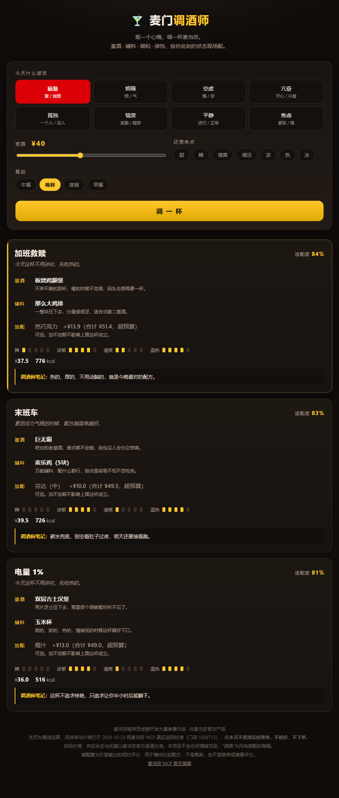

# 🍸 麦门调酒师 · 今日特调

> **报一个心情，调一杯麦当劳。**
>
> 基于**麦当劳中国 MCP** 开发的点餐 Skill：
> 读取当日营销活动、门店在售餐品与可用优惠券，
> 把餐品当作 **基酒 / 辅料 / 调和 / 装饰**，按你此刻的状态现场配一杯。

麦当劳程序员创意开发大赛参赛作品 · 非麦当劳官方产品。


**[👉 在线试算（免安装、免 Token）](https://zhicheng233.github.io/mcd-mixologist/)**　·　[看配方示例](#效果示例)　·　[怎么工作](#怎么工作)



---

## 它回答的不是"哪个便宜"

市面上的点餐助手都在比价。但每天晚上真正难的那个问题是：

> **"我今天这个状态，该吃点什么？"**

加班到十点的人不需要最便宜的方案，需要一杯热的、厚的、不用动脑的。
刚上线成功的人不需要最浓的，需要一杯清亮的、有气泡的。
一个人吃饭的人，需要的是温度，不是折扣。

**同一份菜单，八种心情，应该调出八杯不一样的。**

而这个决策有七八个输入维度（今天什么活动、这家店有什么、我有哪些券、
现在几点、我什么状态、我忌口什么、预算多少），人脑算不过来，
**大模型也算不准**——它会把价格和热量算错。

所以这个项目把决策拆成三段：

| 段 | 谁来做 | 为什么 |
|---|---|---|
| **感知**（今天有什么、多少钱、多少卡） | 麦当劳 MCP | 实时、权威、唯一真相源 |
| **配比**（这些原料怎么搭成一杯） | 确定性算法 | 可复现、可测试、不受幻觉影响 |
| **表达**（怎么说人话） | Agent | 这是大模型唯一不会出错的部分 |

---

## 效果示例

用户说：**「今天加班到十点，晚上想吃点热的，预算 40」**

```
🍸 今日特调 · 疲惫

── 加班救赎 ──
   今天这杯不用讲究，先吃热的。
   基酒　板烧鸡腿堡　不声不响的那杯，喝的时候不觉得，回头总想再要一杯。
   辅料　那么大鸡排　一整块压下去，分量感很足，适合当第二基酒。
   风味　辣 ▮▯▯▯▯　浓郁 ▮▮▮▮▯　清爽 ▮▮▯▯▯
   配比　适配度 84%　¥37.5　776 kcal
   建议加配调和　热巧克力　+¥13.9（合计 ¥51.4，超预算）
   调酒师笔记：热的、厚的、不用动脑的，就是今晚最对的配方。

── 末班车 ──
   累到没力气挑的时候，配方越简单越好。
   基酒　巨无霸　　　　吧台的老基酒，谁点都不会错，但也没人会为它惊喜。
   辅料　麦乐鸡（5块）　万能辅料，配什么都行，缺点是容易不知不觉吃完。
   配比　适配度 83%　¥39.5　726 kcal
   调酒师笔记：碳水兜底，别空着肚子过夜，明天还要接着跑。
```

换一个心情，换一杯（预算 40、晚餐）：

```
烦躁  →  麦辣鸡腿堡 + 蔬菜沙拉            适配度 73%
空虚  →  双层吉士汉堡 + 麦辣鸡翅（2块）     适配度 76%
亢奋  →  吉士汉堡 + 蔬菜沙拉 + 橙汁        适配度 69%
孤独  →  巨无霸 + 玉米杯                  适配度 78%
焦虑  →  板烧鸡腿堡 + 玉米杯               适配度 84%（避开咖啡因与油炸）
```

更多示例见 [`examples/sample-output.md`](examples/sample-output.md)。

---

## 八种心情，六个风味维度

一杯麦当劳的风味画像用 6 个 0~1 的数描述：
**甜 / 辣 / 咸鲜 / 清爽 / 浓郁 / 温热**。

| 心情 | 甜 | 辣 | 咸鲜 | 清爽 | 浓郁 | 温热 | 回避 |
|---|---:|---:|---:|---:|---:|---:|---|
| 疲惫 | 0.35 | 0.15 | 0.70 | 0.30 | 0.80 | **0.90** | 咖啡因 |
| 烦躁 | 0.15 | **0.85** | 0.70 | 0.45 | 0.70 | 0.60 | 糖 |
| 空虚 | 0.40 | 0.30 | 0.85 | 0.15 | **0.95** | 0.75 | — |
| 亢奋 | 0.50 | 0.25 | 0.55 | **0.80** | 0.40 | 0.45 | — |
| 孤独 | 0.60 | 0.10 | 0.55 | 0.35 | 0.70 | **0.95** | — |
| 犒赏 | **0.85** | 0.10 | 0.65 | 0.30 | 0.85 | 0.60 | — |
| 平静 | 0.40 | 0.15 | 0.55 | **0.85** | 0.40 | 0.50 | — |
| 焦虑 | 0.30 | **0.05** | 0.60 | 0.50 | 0.55 | **0.90** | 咖啡因、油炸 |

设计原则：**每种心情至少有一维接近 0、一维接近 1**。
如果都往 0.7 靠，八种心情会推出同一杯——这是做这类推荐器最容易犯的错。

详细推导见 [`references/mood-wheel.md`](references/mood-wheel.md)。

---

## 怎么工作

```
用户：「今天加班到十点，晚上想吃点热的，预算 30」
  │
  ├─ now-time-info ─────────→ 21:47，判定晚餐/夜宵
  ├─ campaign-calendar ─────→ 今天还在跑的活动（"今日限定"的来源）
  ├─ query-nearby-stores ───→ 让用户选门店
  ├─ query-meals ───────────→ 该店在售餐品
  ├─ query-store-coupons ───→ 该店可用券
  │
  ├─ 归一化：在售餐品 ∩ 本地风味库
  │
  ├─ scripts/mix.py ────────→ 确定性配方（本地计算，不消耗 MCP 额度）
  │      心情 → 风味目标 → 9 基酒 × 18 辅料 × 10 调和 全枚举 → Top 3
  │
  ├─ calculate-price ───────→ 核价，确认券真的减了
  ├─ list-nutrition-foods ──→ 复核热量
  │
  └─ 输出特调卡片（用户明确要求时才 create-order）
```

**配方搜索是纯本地计算。** 1600 多种组合枚举一遍只要几十毫秒，
放在 MCP 侧会直接打爆 600 次/分钟的限流，而且完全没必要——
MCP 的职责是"告诉我今天有什么"，不是"帮我想"。

### 打分逻辑

```
风味相似度 = 1 − 归一化欧氏距离(整杯风味, 心情目标)
适配度     = 校准后(相似度 + 结构分 − 忌口扣分 − 温度错配 − 预算超额)
```

> 为什么不用余弦相似度？因为风味向量的每一维都是 0~1 的非负数，
> 余弦在任何两个"都挺浓"的向量之间都会逼近 1，八种心情会给出同一杯。
> 这个坑在开发时踩过，记在 [`references/mood-wheel.md`](references/mood-wheel.md) 里。

---

## 安装

### 1. 申请麦当劳 MCP Token

前往 [open.mcd.cn/mcp](https://open.mcd.cn/mcp) → 手机号登录 → 右上角「控制台」→「激活」→ 复制 Token。

### 2. 配置 MCP 连接器

把 [`mcp-config.example.json`](mcp-config.example.json) 的内容填进你的客户端
（WorkBuddy / Cherry Studio / Cursor / Trae 均可），**记得把 `YOUR_MCP_TOKEN` 换成真实 Token**。

### 3. 安装 Skill

把整个仓库目录放进 WorkBuddy 的技能目录（`~/.workbuddy/skills/`），
或让客户端读取 [`SKILL.md`](SKILL.md)。

### 4. 跑一遍自测

```bash
python scripts/mix.py --selftest
```

不需要 Token，不需要联网，不需要第三方库。

---

## 使用示例

**直接调引擎**（不接 MCP 也能跑，用离线风味库）：

```bash
# 一句话模式，引擎自己抽心情、预算、忌口
python scripts/mix.py --text "今天加班到十点，晚上想吃点热的，预算30，不要咖啡因"

# 结构化模式
python scripts/mix.py --mood irritable --budget 45 --meal dinner

# 给 Agent 用的 JSON 输出
python scripts/mix.py --mood lonely --budget 30 --json
```

**在 WorkBuddy 里**：

```
用麦门调酒师。今天被需求改到第五版，有点烦，预算 40，不吃辣。
```

```
我今天状态特别好，刚上线成功，想吃点清爽的，别太油。
```

**看有哪些心情**：

```bash
python scripts/mix.py --list-moods
```

---

## 验证记录

| 范围 | 已验证内容 |
|---|---|
| 引擎自测 | 12 项断言：数据越界、确定性、预算硬约束、忌口过滤、心情区分度、自然语言解析、每杯必有基酒 |
| 全组合冒烟 | 8 心情 × 4 餐段 × 7 预算 = 224 组，无异常、无超预算漏网、每杯必有基酒 |
| 心情区分度 | 8 种心情首杯两两比对，基酒与配方无重复 |
| **Python / JS 逐字段比对** | 8 心情 × 4 餐段 = 32 组、88 杯，名称 / 适配度 / 价格 / 热量 / 配方 / 笔记**全部一致**（djb2 签名 32/32 命中） |
| 离线 Demo | Chrome 实机加载，0 控制台报错；JS 打分结果与 Python 引擎逐字段一致 |
| 数据一致性 | Demo 页面由 `scripts/build_demo.py` 从同一份 JSON 生成，不存在两边手写漂移 |
| **真实 MCP 联调** | ✅ **2026-10-23 完成**：7 个核心 Tool 全部跑通，含带券核价 ¥34.00 → ¥20.48 |

### 联调带来的数据修正

拿到真实 Token 后，用 `list-nutrition-foods` 和 `query-meals` 把离线数据整体校准了一遍：

| 项 | 修正 |
|---|---|
| 热量 | 26 个餐品换成官方 `energyKcal`（巨无霸 550 → **513**，圆筒 150 → **93**，玉米杯 110 → **87**） |
| 价格 | 23 个餐品换成门店 1450713 当日 `currentPrice`（板烧 ¥21.5 → **¥23.5**，玉米杯 ¥9 → **¥13**） |
| SKU | 25 个餐品补了真实 `productCode`，Agent 可直接映射到 `calculate-price` |

联调还暴露出 3 个解析坑，已修并写进 [`MCP_INTEGRATION.md`](MCP_INTEGRATION.md#4-数据流与字段处理)：
金额单位是**分**不是元、`query-meals` 的 `data.meals` 是**以 productCode 为键的对象**不是数组、
券接口没有 `## Original Response` 标记会被说明层里的花括号带偏。

---

## 已知限制

- **只测了到店自取。** 外送链路（`delivery-query-addresses` / `delivery-query-stores`）
  需要真实配送地址，尚未联调。得来速（`beType=5`）同理。
- **没有下单、没有领券。** `create-order` 与 `auto-bind-coupons` 会产生真实后果，
  联调全程只读。
- **价格是单店单日快照。** 已用门店 1450713（上海）2026-10-23 的价格校准，
  但不同城市、门店、时段会有差异，正式展示前必须 `calculate-price` 复核。
- **不保证全网最低价。** 本项目做的是"当下状态下的合适搭配"，不是比价器。
- **风味库只收录 33 个常见餐品。** 该门店当日实际在售 124 个 SKU（早餐时段另有一套），未收录的会被跳过；
  其中 6 个餐品（吉士汉堡单品、蔬菜沙拉、芬达、豆浆、猪柳麦满分、吉士蛋麦满分）
  在该店当日不可售，价格仍为估算值，已用 `price_verified: false` 标出。
- **餐段是三态硬规则。** `breakfast` 只在早餐出现，`main` 只在 10:30 之后出现，
  `all`（饮品）全天可用。所以早餐不会推出炸鸡，晚上也不会推出麦满分。
- **夜宵额外回避咖啡因。** 午餐和晚餐的菜单确实一样，但夜里再上一杯美式没有道理，
  所以 `late-night` 会给含咖啡因的饮品扣分。
- **加配建议不会和"回避"打架。** 卡片上写着"避开油炸"，就不会再推荐油条。
- **不含医疗或营养建议。** 热量仅用于口味与分量参考。
- **不含酒精。** "调酒"是风味搭配的隐喻，麦当劳也不售卖酒精饮料。

---

## 项目结构

```
├── SKILL.md                     # Skill 定义与六步工作流（Agent 读这个）
├── README.md
├── MCP_INTEGRATION.md           # 用了哪些 Tool、调用流程、业务价值
├── CONTEST_DECLARATION.md       # 参赛声明（官方原文，未改动）
├── mcp-config.example.json      # 脱敏配置示例，仅环境变量占位符
├── workbuddy.md                 # WorkBuddy 开发上下文
├── LICENSE                      # MIT
├── data/
│   ├── flavor-db.json           # 33 个餐品的风味标签
│   └── mood-db.json             # 8 种心情 → 风味目标向量
├── scripts/
│   ├── mix.py                   # 确定性配方引擎（零依赖）
│   └── build_demo.py            # 从 JSON 生成在线 Demo
├── templates/
│   ├── demo.template.html       # Demo 模板
│   └── menu-card.html           # 特调卡片模板
├── references/
│   ├── mood-wheel.md            # 心情风味轮
│   ├── mcd-tools.md             # MCP 工具速查与调用纪律
│   └── bartender-voice.md       # 话术规范
├── docs/
│   ├── index.html               # 在线试算页（GitHub Pages）
│   └── preview.png              # 页面截图
└── examples/
    └── sample-output.md         # 八种心情的实际输出
```

---

## 关于"调酒"这个说法

全程**没有任何酒精**。麦当劳不卖酒，这个 skill 也不推荐酒。

选这个词是因为它准确：调酒师做的事就是**把几样现成的东西按比例配成一杯**，
而且他会告诉你"今晚这杯别喝太晚"。点餐推荐本质上是一回事。

---

## 参赛信息

- 赛事：麦当劳程序员创意开发大赛（2026 1024 程序员节）
- 官方仓库：[M-China/mcd-developer-innovation-challenge](https://github.com/M-China/mcd-developer-innovation-challenge)
- MCP 指南：[M-China/mcd-mcp-server](https://github.com/M-China/mcd-mcp-server)
- 本项目为参赛作品，非麦当劳官方产品。餐品信息、价格及供应状态以麦当劳官方渠道的实时结果为准。
